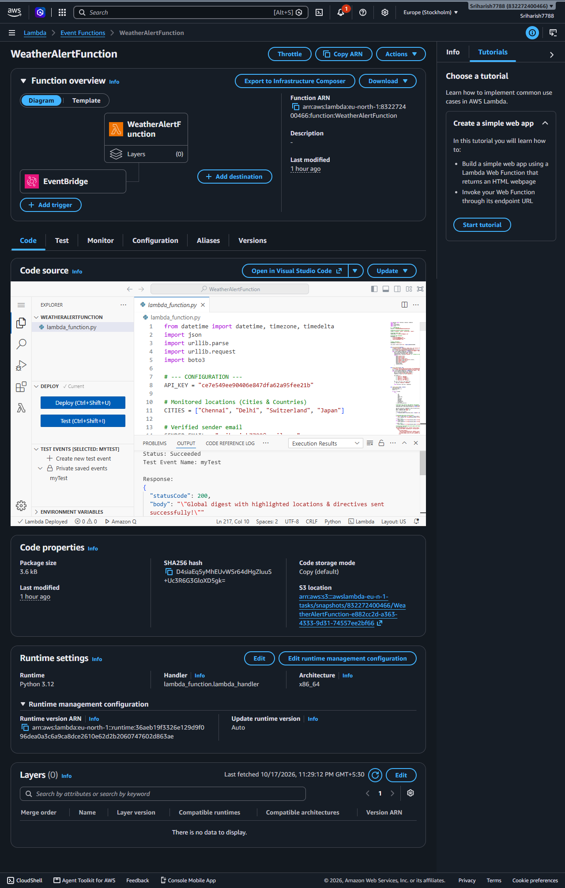
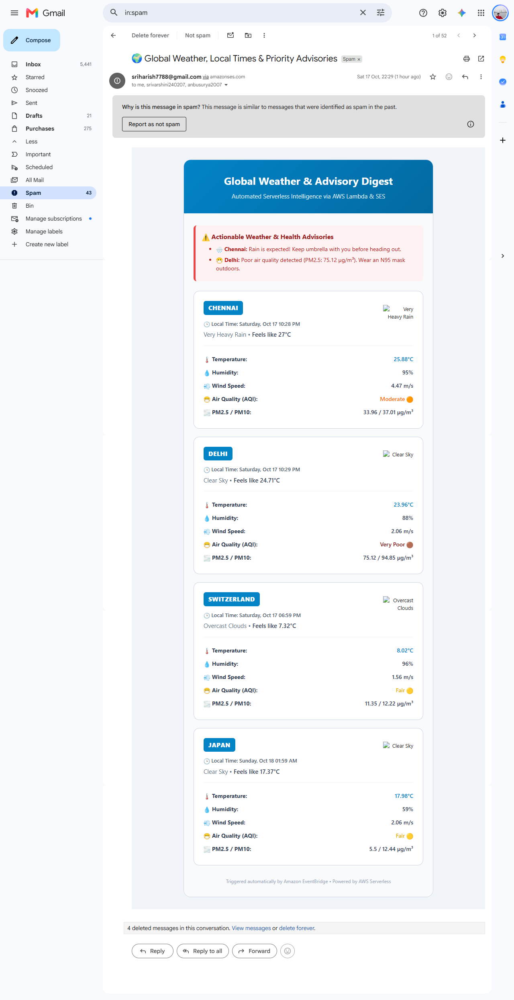

# Personalized Weather Report and Alert System Using AWS Lambda

An enterprise-grade, serverless cloud application that automates real-time global weather tracking, Air Quality Index (AQI) monitoring, and condition-based health advisories delivered to users on a daily schedule using Amazon EventBridge and Amazon SES.

---

## 🏛️ Academic & Team Details
* **Institution:** Sathyabama Institute of Science and Technology (Deemed to be University)
* **Department:** Department of Computer Science and Engineering
* **Course:** Professional Training - I (PT-1)
* **Domain:** AWS Cloud Computing

| Student Name | Register Number | Project Guide | Role & Contribution |
| :--- | :--- | :--- | :--- |
| **Sri Harish P** | 44110805 | Dr. P. Rajasekar | System Architecture, AWS Lambda Core Pipeline & EventBridge Triggers |
| **Srivarshini V** | 44110814 | Dr. S. Prince Mary | Weather & Air Quality API Integration, Local Timezone Processing |
| **Surya A** | 44110832 | Dr. T. Prem Jacob | Amazon SES Configuration, Responsive HTML Template Design & AWS IAM Security |

---

## 🌟 Key Features
* **Global Location Intelligence:** Tracks multiple domestic and international locations (**Chennai, Delhi, Switzerland, Japan**).
* **Automatic Local Time Calculation:** Calculates exact local wall-clock times for each location using dynamic UTC timezone offsets.
* **Environmental Health Metrics:** Integrates OpenWeather Air Pollution API to track **AQI levels** and particulate matter (**PM2.5 and PM10**).
* **Actionable Advisories:** Automatically generates alerts for:
  * 🌧️ Precipitation & rainfall warnings (recommending umbrellas).
  * 🔥 Extreme heatwave advisories ($\ge 38^\circ\text{C}$).
  * ❄️ Freezing temperature alerts ($\le 5^\circ\text{C}$).
  * 😷 High pollutant advisories (PM2.5 $> 50\,\mu\text{g/m}^3$ recommending N95 masks).
* **Responsive HTML Digests:** Delivered directly to registered subscriber inboxes using custom CSS-styled card components.
* **100% Serverless Automation:** Executes on an automated daily timer at 07:00 AM IST with zero dedicated server maintenance overhead.

---

## ☁️ Architecture & Services Used
* **AWS Lambda (Python 3.12):** Serverless compute engine that fetches and processes multi-city data concurrently.
* **Amazon Simple Email Service (SES):** Bulk transactional email delivery engine configured in `eu-north-1` (Stockholm).
* **Amazon EventBridge:** Daily event-driven cron scheduler (`cron(30 1 * * ? *)`).
* **AWS IAM:** Custom `WeatherLambdaRole` maintaining strict least-privilege policies.
* **OpenWeatherMap APIs:** `/weather` and `/air_pollution` REST endpoints.

---

## 📂 Repository Layout
```text
├── backend/
│   └── lambda_function.py     # Main Python 3.12 AWS Lambda handler
├── infrastructure/
│   └── template.yaml          # AWS SAM/CloudFormation Infrastructure as Code
└── README.md                  # Comprehensive project report & setup documentation
```

## 📸 Output Demonstration

### AWS Lambda & EventBridge Architecture


---

### Delivered HTML Weather & Air Quality Digest

